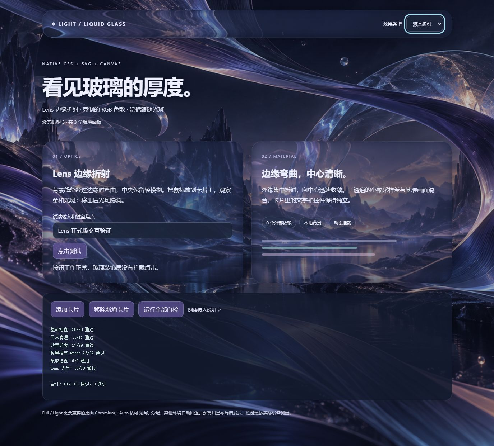

# light-liquid-glass

测试环境：2026-10-22，Windows、Node.js v26.12.1。可见性与安卓兼容分支通过 50 项 host 检查，Lens 贴图已通过 75 组逐字节对比。上一版于 2026-10-21 通过 Chromium 116/116 项检查；用户已反馈安卓 Edge Light 测试正常；本轮完整浏览器检查及安卓 Full 真机画面待验收，GPU 帧耗时尚未测量。详细结果见 [VALIDATION.md](demo/VALIDATION.md)。

[English](README.md) · 中文

一个用原生 HTML、CSS 和 JavaScript 实现的液态玻璃效果。圆形 Lens 曲线把折射集中在外缘，RGB 色散与基准画面小比例混合；中间只保留一点模糊，让背景细节还能看清。

Designed for websites。核心文件和中英文 README 放在根目录，演示、验证记录、背景图和检查脚本放在 `demo/`。下面的命令从仓库根目录运行。



这个效果最初用在聊天界面上，后来整理成了可以单独接入的两个文件。鼠标移入时会出现跟随光斑，移出后光斑隐藏。它不需要前端框架、npm 依赖、CDN 或 WebGL。

## 先跑起来

用 Node.js 18+ 启动演示：

```sh
node demo/server.mjs
```

打开 <http://localhost:4178>。顶栏可以切换自动、液态折射、轻量折射、毛玻璃和纯色。参数面板提供折射幅度（0–200）、色散（0–50）、边缘带宽（1–120px）和液态背景模糊（0–12px，步长 0.1）滑块：拖动时显示数值，松开后应用，也支持方向键微调。“恢复默认参数”回到 110 / 14 / 44px / 3px。调节保留输入内容、动态卡片和当前效果档位；刷新页面后参数回到默认值。下方可以添加、移除卡片，或运行全部自检。演示服务器默认只监听本机。手机测试时，让手机与电脑处于可互通的局域网；在 PowerShell 设置 `$env:HOST="电脑的局域网 IPv4"; $env:PORT="4179"; node demo/server.mjs`，再在手机打开 `http://电脑的局域网IPv4:4179/`。只提供演示白名单文件，不浏览项目目录。

## 放进现有页面

复制 `glass.css` 和 `glass.js`，让现有静态服务能访问它们。背景图和演示服务器都是可选的。一个完整页面可以这样写：

```html
<!doctype html>
<html lang="zh-CN">
<head>
  <meta charset="utf-8">
  <meta name="viewport" content="width=device-width, initial-scale=1">
  <title>玻璃卡片</title>
  <link rel="stylesheet" href="./glass.css">
  <style>
    body { margin: 0; padding: 40px; color: white; background: url('./demo/background.png') center / cover fixed #101226; }
    .card { max-width: 440px; padding: 28px; }
  </style>
</head>
<body>
  <article class="lg-glass card" data-liquid-glass>
    <h1>液态玻璃</h1>
    <p>背景线条经过卡片边缘时发生弯曲与色散。</p>
    <button type="button">原有控件可以正常交互</button>
  </article>
  <script type="module">
    import { createLiquidGlass } from './glass.js';
    const glass = createLiquidGlass();
    // 动态添加或删除玻璃卡片后调用 glass.refresh()。
    // 页面组件卸载时调用 glass.destroy()。
  </script>
</body>
</html>
```

选一张有线条、明暗或纹理的背景，会更容易看出边缘折射。样式只作用于 `.lg-glass`，不重置页面布局、字体和按钮。`::before` 伪元素用来画鼠标光斑，接入时留意已有组件是否占用了它。

## 控制效果

```js
import { createLiquidGlass } from './glass.js';

const glass = createLiquidGlass({
  root: document,               // 也可以传入一个已连接到页面的容器元素
  quality: 'auto',              // auto | full | light | frost | solid
  optics: {                     // 光学形态，可省略；下面是默认值
    refraction: 110,             // 0..200
    dispersion: 14,             // 0..50
    edgeWidth: 44               // 1..120，CSS 像素
  },
  onChange(state) {
    console.log(state.quality, state.full, state.light, state.frost, state.solid);
  }
});

glass.setQuality('full');        // 申请液态模式；不兼容时仍会回退
glass.refresh();                 // 同步新增/移除的卡片；同尺寸不会重算贴图
console.log(glass.getState());   // 元素、滤镜、缓存、累计贴图生成次数
glass.destroy();                 // 释放监听器、观察器、RAF、定时器、滤镜和缓存
```

`setQuality('full')` 或 `setQuality('light')` 会申请对应折射效果；环境不兼容时仍然回退。想让个别卡片一直使用毛玻璃，可以写 `data-liquid-glass="frost"`。

`optics` 调整光学形态：`refraction` 默认 110（0 到 200），`dispersion` 默认 14（0 到 50），`edgeWidth` 默认 44（1 到 120）。字段只接受有限数字；字符串、`NaN`、`Infinity` 等会在创建控制器资源之前抛出 `TypeError`，有限值超出范围时限制到边界。大卡片的贴图降采样时，边缘带也同比缩小，保持 CSS 像素范围。要更换参数，先销毁旧控制器，再创建新控制器。

正式版统一使用 Lens，旧宽弧面模型已移除。`D = dispersion / 50`，通道序号为 0、1、2 时，位移强度是 `refraction * (1 + (通道序号 - 1) * D * 0.006)`，默认约为 109.8152/110/110.1848。RGB 合成结果只按 `0.20 * D` 混入绿色通道的基准画面（D ≤ 0.001 时不混入），默认混合量为 5.6%。原有参数名和范围保留，色散数值的视觉含义已改变。

尺寸变化会自动更新。动态增加或移除卡片后调用 `refresh()`；如果只改了圆角等样式，也主动调用一次。组件卸载时调用 `destroy()`，它会释放事件、观察器、动画帧、定时器、SVG 和缓存，并恢复接管前的 inline 样式与状态属性。重复销毁不会报错，需要再次使用时新建一个控制器。

一个容器通常只需要一个控制器。重复控制同一元素时，后创建的控制器会跳过已有归属的元素。`root` 自身带标记时也会纳入。

首次 `onChange` 在初始化过程中同步执行。它或挂载过程抛错时，控制器会先清理已创建的资源、恢复元素，再抛出原异常。之后 `refresh()` 的回调异常仍向调用方抛出，可用已取得的 `destroy()` 清理。

引擎不读写业务存储，也不替页面保存偏好。`demo.js` 演示了选择框和 localStorage 的接法。

## 调整材质

```css
.my-panel {
  --lg-radius: 28px;
  --lg-center-blur: 3px;    /* 液态模式中心轻模糊 */
  --lg-frost-blur: 6px;      /* 毛玻璃模式模糊 */
  --lg-solid: #1b253b;
  --lg-tint: linear-gradient(135deg, #c2ceff1e, #23315388 65%, #bbc6ff10);
  --lg-glow-width: 210px;    /* 光斑横向渐变半径 */
  --lg-glow-height: 130px;   /* 光斑纵向渐变半径 */
  --lg-glow-opacity: 1;      /* 光斑显示时的不透明度 */
}
```

边缘作用带默认上限 44 个 CSS 像素（短卡片按比例收窄；贴图降采样时同比缩小）。鼠标光斑的渐变半径默认 210/130px。继续调整光学形态时，可以查看 `glass.js` 的 `makeDisplacementMap`、`ensureFilter`，以及 `glass.css`。

## 浏览器自检

在演示页点击“运行全部自检”，可以依次检查生命周期、参数、质量档位、集成行为和 Lens 光学，共 106 项。只检查参数时，也可以在浏览器控制台运行：

```js
const { runParameterChecks } = await import('./parameters-checks.js');
await runParameterChecks(document.querySelector('#check-results'));
```

输出 PASS/FAIL/SKIP，覆盖 optics 校验与钳制、贴图边缘宽度、通道强度和光斑变量。环境回退、不支持 Full 时，相关光学检查会标记为 SKIP。`checks.js` 负责控制器生命周期。

## 实现和开销

轻量档 `light` 使用单次位移，强度取 `optics.refraction`，默认 110。它与 Full 共用弧面贴图，省去 RGB 分通道和颜色合成。切换档位会复用贴图。

桌面 Auto 静止时对每个控制器最多分配 3 块 Full 面板，其与视口相交的面积总和不超过 40 万 CSS 像素。可见面积较大的面板优先，同面积按挂载顺序；其余可见面板使用 Light。滚动或拖动窗口尺寸时，Full 面板暂用单次折射；IntersectionObserver 通知新卡片进入视口后，下一动画帧就启用 Light，不必等 120ms 停顿。离屏卡片释放 SVG 滤镜，关闭背景模糊、阴影和光斑，保留布局与内容节点；停止操作 120ms 后才恢复 Full 预算。手动 Full 保留显式渲染行为。相交检测是异步的，不检查遮挡与 CSS 透明度，也不代表帧率承诺。缺少 IntersectionObserver 时，每个滚动帧最多批量检查一次可见性。

Canvas 在初始化或尺寸变化时生成一张位移贴图。设距外缘向内的归一化距离为 `t = clamp(-d / band, 0, 1)`，Lens 强度为 `1 - sqrt(1 - (1 - t)^2)`；光学法线使用 1.5 倍圆角半径，并受短边半径限制。`full` 的 SVG 合成 RGB 后与基准采样混合，`light` 只做一次基准位移。文字和控件不经过背景滤镜。鼠标移动只更新 CSS 光斑位置，不会重新生成贴图。

一个控制器共用一个 ResizeObserver 和一个鼠标动画帧。刷新先批量读取几何和圆角，再修改材质；尺寸不变时避免重复写样式。自动尺寸刷新不再扫描成员，动态增减元素仍需显式 `refresh()`。贴图使用最多 8 张的 LRU 缓存，保留最近访问的尺寸；生成时跳过中性中心，Lens 像素不变。每张贴图约限 36 万像素，单卡片超过 120 万 CSS 像素会回退毛玻璃。`getState().opticalModel` 固定为 `lens`。

`node demo/refresh-checks.mjs` 运行 50 项 host 调度与兼容分支检查，`node demo/performance.mjs` 对比优化前后 75 组贴图并交替采样 CPU 耗时。它们不替代浏览器或 GPU 验证。演示页“运行全部自检”包含 9 项连续滚动进入与离屏释放检查；安卓 Auto 使用 Light，手动 Full 运行三通道光学检查；未实际运行的检查不算已验收。

运行 `node demo/benchmark.mjs` 可检查当前 Lens 贴图并测量 CPU 计算时间；它只包含像素数学和数组写入，不包含 PNG 编码、浏览器合成或 GPU 渲染。Full/Light 的背景模糊使用折射后的浏览器高斯模糊，默认 3px；没有复现 native 的有限 25 点采样核，也不声明与 native 逐像素一致。普通列表可使用 `data-liquid-glass="frost"`。

## 兼容范围

桌面 Chromium 使用 SVG backdrop-filter 的 Full / Light 路径。安卓 Chromium（包括带 Android UA 的 Edge）试验开放 Full / Light：自动使用单次 Light，手动选择“液态折射”启用三通道 Full，“轻量折射”使用 Light，不再因触屏直接回退；毛玻璃和纯色仍可手动选择，触摸事件不驱动鼠标光斑。`getState().compatibility` 返回 `android-experimental`、`desktop` 或 `unsupported`；安卓折射激活时演示页会标注“安卓试验支持”。iOS、Firefox 等环境继续回退，桌面粗主指针策略保持不变。

能力检测通过只说明它是候选环境，不能证明手机 GPU 正确渲染 SVG 背景采样。CSS 检测或 Canvas 创建失败时仍回退毛玻璃；用户已反馈安卓 Edge Light 测试正常；Full 的画面和流畅度仍需真机确认。系统要求减少透明度时使用纯色，要求减少动画时隐藏鼠标光斑。

贴图按统一的圆角矩形生成，四个角应使用相同的非椭圆圆角，推荐设置 px 单位的 `--lg-radius`。避免嵌套多层玻璃，或直接缩放、旋转玻璃元素，这些操作会改变采样与坐标关系。

如果项目有严格 CSP，需要允许本地模块、生成贴图的 `data:` 图片和必要的动态 style 更新。保留现有保护，只增加所需规则。使用文件白名单的静态服务需要登记效果文件和背景图。

## 文件

除核心文件外，下表中的文件都位于 `demo/`。

| 文件 | 用途 |
| --- | --- |
| `glass.js` / `glass.css` | 核心效果，业务接入只需要这两个文件 |
| `index.html` / `demo.js` / `demo.css` | 演示页面、选择框和偏好保存示例 |
| `background.png` | AI 生成的演示背景，可替换 |
| `checks.js` | 浏览器内的 20 项自检 |
| `parameters-checks.js` | optics、边缘宽度与 CSS 变量的浏览器参数自检 |
| `quality-checks.js` | 轻量滤镜、模式切换和 Auto 预算自检 |
| `lifecycle-checks.js` / `integration-checks.js` | 异常回滚、跨档参数和绘图回退自检 |
| `lens-checks.js` | Lens 曲线、色散混合和跨档恢复自检 |
| `performance-checks.js` | 浏览器中的滚动轻量、恢复与销毁检查 |
| `performance.mjs` / `refresh-checks.mjs` | 像素一致性、CPU 对比及 host 调度检查 |
| `benchmark.mjs` | 当前 Lens 贴图数学检查与 CPU 计时 |
| `server.mjs` | 本机演示服务器 |
| `VALIDATION.md` | 已执行检查和未覆盖范围 |
| `preview.png` | README 截图 |
| `manifest.sha256` | 文件完整性清单 |

代码和文档使用 AI 辅助编写，演示背景使用 AI 生成。

参考：[MDN backdrop-filter](https://developer.mozilla.org/en-US/docs/Web/CSS/Reference/Properties/backdrop-filter)、[MDN ResizeObserver](https://developer.mozilla.org/en-US/docs/Web/API/ResizeObserver)、[MDN feDisplacementMap](https://developer.mozilla.org/en-US/docs/Web/SVG/Reference/Element/feDisplacementMap)。
